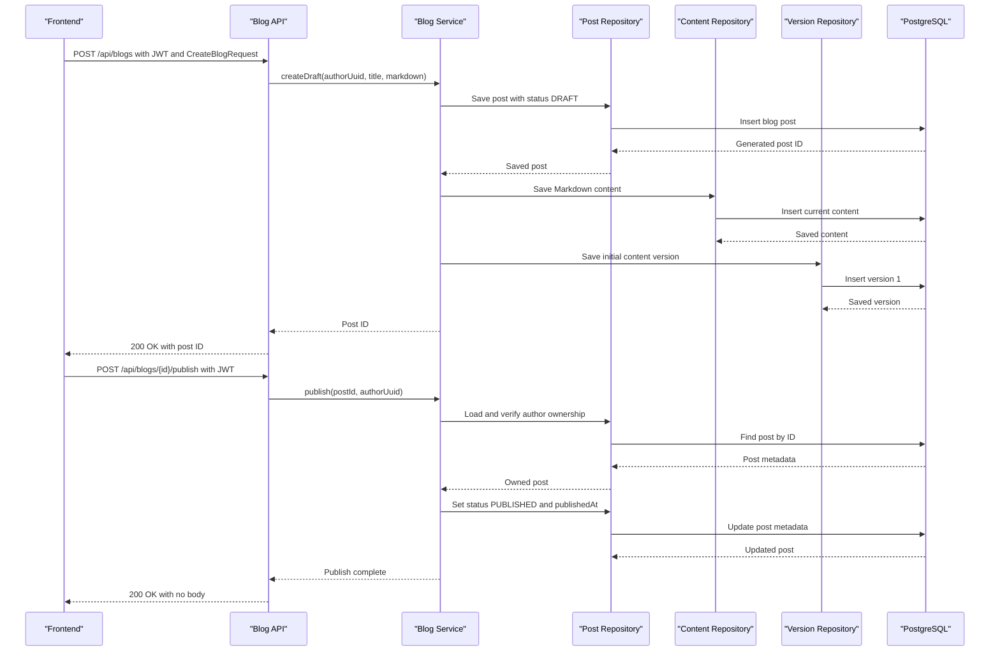

# API & Service Communication Contracts

The Blog Service exposes seven REST endpoints under `/api/blogs`, using synchronous JSON requests and responses. For frontend integration, draft creation and publishing are separate operations; there is no dedicated endpoint that returns published posts only.

## Frontend Integration: Draft and Published Posts

All examples use `https://<blog-service-host>` as the base URL. Send JSON with `Content-Type: application/json`. Mutating requests require `Authorization: Bearer <JWT>`; the JWT subject must be the author's UUID.

### Create a draft

`POST /api/blogs` creates a post in `DRAFT` status and returns the numeric post ID as the response body.

```http
POST /api/blogs
Authorization: Bearer <JWT>
Content-Type: application/json

{
  "title": "My article",
  "markdown": "# Article content"
}
```

Example response:

```json
42
```

The service also saves the Markdown as the current content and records the initial content version. Both `title` and `markdown` must be nonblank.

The UI creates a draft with this endpoint. To publish immediately, it creates the draft first and then calls `POST /api/blogs/{id}/publish`.

### Edit a draft or published post

`PUT /api/blogs/{id}` updates the title and Markdown for a post owned by the authenticated author. It does not change the post's status, so editing a published post leaves it published.

```http
PUT /api/blogs/42
Authorization: Bearer <JWT>
Content-Type: application/json

{
  "title": "Revised article",
  "markdown": "# Revised content"
}
```

Success response: `200 OK`, with no response body. Each update also creates a new content version.

Because this endpoint updates the current content even when the post is already published, a UI edit to a published post is immediately public. The current API has no operation to save an unpublished revision while retaining the prior published content; the UI must not present saving a published edit as a draft until that API capability exists.

### Publish a post

`POST /api/blogs/{id}/publish` changes the owned post's status to `PUBLISHED` and sets `publishedAt`.

```http
POST /api/blogs/42/publish
Authorization: Bearer <JWT>
```

Success response: `200 OK`, with no response body. The frontend can then refresh the metadata to display the new status and publication time. There is no separate publish request body, unpublish endpoint, or archive endpoint. Publishing an already-published post sets `publishedAt` again.

### Read posts

- `GET /api/blogs?page=0&size=20` returns a paginated list of metadata.
- `GET /api/blogs/{id}/metadata` returns metadata for one post.
- `GET /api/blogs/{id}/content` returns the Markdown content.

The metadata response includes `status` (`DRAFT` or `PUBLISHED`) and `publishedAt` (null for a draft). The list endpoint currently returns **both drafts and published posts** and has no status filter. A frontend may filter list results by `status` for display, but client-side filtering is not a privacy control: all three GET routes are public, including draft content. If drafts must remain private, the backend needs server-side status filtering and access control before exposing these routes publicly.

The UI shows only published posts in the public blog listing and restricts draft links to their author in the UI. The signed-in profile lists that author's drafts first, followed by their published posts. These display rules do not replace backend authorization for draft reads.

### Responses and errors

Metadata has the shape below; author profile data may be present when available.

```json
{
  "id": 42,
  "authorId": null,
  "authorUuid": "00000000-0000-0000-0000-000000000001",
  "authorProfile": null,
  "title": "My article",
  "slug": "my-article",
  "status": "DRAFT",
  "createdAt": "2026-10-31T07:30:00Z",
  "publishedAt": null
}
```

Content responses have the shape:

```json
{
  "postId": 42,
  "content": "# Article content",
  "format": "MARKDOWN"
}
```

An unknown post returns `404`; an authenticated author who does not own a post receives `403` for mutation requests. Missing or invalid authentication is rejected by Spring Security. Request DTOs require nonblank title and Markdown; there is no dedicated validation-error response contract, so frontend code should not rely on a particular validation response body.

## Service Catalog

| Service | Port | Category | Purpose |
|---|---:|---|---|
| Blog Service (`blog`) | 8080 | Business / API | Creates, manages, publishes, and serves blog posts. |
| Profile Service | Not specified here | External business dependency | Supplies public author profile data to blog metadata responses. It is called at `/api/v1/profiles/{profileId}`. |

## API Endpoints Inventory

| Service | Method | Path | Request Type | Response Type |
|---|---|---|---|---|
| Blog Service | POST | `/api/blogs` | `CreateBlogRequest` JSON; bearer JWT | `Long` post ID; 200 |
| Blog Service | GET | `/api/blogs` | Pageable query parameters (`page`, `size`, `sort`) | `Page<BlogMetadataResponse>`; 200 |
| Blog Service | GET | `/api/blogs/{id}/metadata` | `id` path parameter | `BlogMetadataResponse`; 200, or 404 |
| Blog Service | GET | `/api/blogs/{id}/content` | `id` path parameter | `BlogContentResponse`; 200, or 404 |
| Blog Service | PUT | `/api/blogs/{id}` | `id`, `UpdateBlogRequest` JSON, bearer JWT | Empty response; 200, 403, or 404 |
| Blog Service | DELETE | `/api/blogs/{id}` | `id`, bearer JWT | Empty response; 204, 403, or 404 |
| Blog Service | POST | `/api/blogs/{id}/publish` | `id`, bearer JWT | Empty response; 200, 403, or 404 |

## Management & Observability Endpoints

| Service | Endpoint | Custom Metrics |
|---|---|---|
| Blog Service | `/actuator/health`, `/actuator/info`, `/actuator/metrics`, `/actuator/prometheus` | `blog.drafts`, `blog.posts.published`, `blog.posts.deleted`, `blog.posts.updated`, `blog.versions.saved`, `blog.posts.not_found`, and `blog.operation.duration` |

## DTOs & Contracts

- `CreateBlogRequest` and `UpdateBlogRequest` are mutable JSON request DTOs.
- `BlogMetadataResponse` and `BlogContentResponse` are mutable JSON response DTOs.
- `AuthorProfileResponse` is an immutable Java record returned by the Profile Service and included in metadata when available.
- `BlogPost`, `BlogPostContent`, and `BlogPostVersion` are service-owned persistence entities, not frontend request DTOs.
- The service uses Jackson JSON serialization. No OpenAPI/Swagger specification was found.

## Communication Patterns

- Frontend-to-Blog Service communication is synchronous REST over HTTP/JSON. The service runs on port 8080; TLS termination is not configured in the application and must be provided by the hosting platform if HTTPS is required.
- Blog operations use direct service-to-repository calls. The Blog Service calls the Profile Service synchronously using HTTP GET to enrich metadata; the configured connection and read timeouts default to 2 seconds and 3 seconds. A missing or unavailable profile is omitted from the metadata response. No retry or circuit-breaker policy is configured.
- No message broker, asynchronous service communication, service discovery, or API gateway is defined in this project.
- Mutating `/api/blogs` endpoints require a JWT bearer token. The decoder validates the configured issuer and audience, requires a future expiration, and requires a UUID subject. GET endpoints are public. CORS permits any origin and the GET, POST, PUT, and DELETE methods.
- There is no server-side published-only listing. The list, metadata, and content GET endpoints can expose draft posts without authentication.

## Service Technology Matrix

| Service | Web | Data Access | Discovery | Gateway | Actuator | Cache | Metrics |
|---|---|---|---|---|---|---|---|
| Blog Service | Spring MVC | Spring Data JPA | None | None | Yes | Used for profile lookups | Prometheus |
| Profile Service | External REST API | Not known | Not known | Not known | Not known | Not known | Not known |

## Service Communication Sequence

<!-- mermaid-checked: every participant uses `participant Id as "Label"`, no \n in aliases/messages/notes, every alt/opt/loop closed by end, no `:` inside any alias -->

