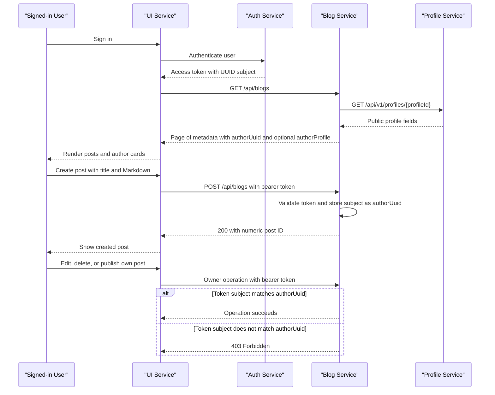

# UI Service Context — Blog Posts Linked to Profiles

## Purpose

Use this handoff to update the UI to show blog authors from Profile Service
profiles and to support authenticated, owner-only blog management. The Blog
Service stores the authenticated user's UUID on each new post, exposes it as
`authorUuid`, and embeds an optional public `authorProfile` in blog metadata.

## Services and identity

- **Auth Service** authenticates users and issues access tokens. The token's
  verified `sub` is the user's canonical UUID.
- **Profile Service** owns profile information, including public author details.
- **Blog Service** owns blog content and stores the author's UUID. It does not
  create profiles; it resolves and embeds the public author projection in blog
  metadata.

The UI must not contain the JWT signing secret or try to authorize a write
based solely on client-side identity checks. Send the Auth Service access token
to Blog Service as a bearer token; Blog Service validates it and enforces
ownership. The UI's owner comparison is only for presentation.

## Blog Service API contract

Configure the Blog Service API base URL per environment. The routes below are
relative to it.

| Method | Path | Authentication | Response / behavior |
|---|---|---|---|
| `GET` | `/api/blogs` | Public | Paginated `Page<BlogMetadataResponse>` |
| `GET` | `/api/blogs/{id}/metadata` | Public | `BlogMetadataResponse` |
| `GET` | `/api/blogs/{id}/content` | Public | `BlogContentResponse` containing raw Markdown |
| `POST` | `/api/blogs` | Bearer access token required | `200` with numeric post ID |
| `PUT` | `/api/blogs/{id}` | Owner's bearer access token required | `200` with no response body |
| `DELETE` | `/api/blogs/{id}` | Owner's bearer access token required | `204` with no response body |
| `POST` | `/api/blogs/{id}/publish` | Owner's bearer access token required | `200` with no response body |

Blog metadata includes the existing `authorId` property and the new stable
`authorUuid` property. It also includes `authorProfile`, either `null` when no
profile is available or a public profile projection with `userId`,
`displayName`, `bio`, `avatarUrl`, and `createdAt`. `authorId` is a legacy
numeric value; it is not a Profile Service profile ID and must not be used for
profile lookup or ownership checks. Older/anonymous posts may have no
`authorUuid`; treat it as unavailable.

Example metadata:

```json
{
  "id": 42,
  "authorId": null,
  "authorUuid": "8c0c0b42-ff2a-4d68-b90f-3b845ca8106a",
  "authorProfile": {
    "userId": "8c0c0b42-ff2a-4d68-b90f-3b845ca8106a",
    "displayName": "Ada",
    "bio": "Engineer",
    "avatarUrl": "https://images.example.test/ada.png",
    "createdAt": "2026-10-18T12:00:00Z"
  },
  "title": "Building Services",
  "slug": "building-services",
  "status": "PUBLISHED",
  "createdAt": "2026-10-18T12:00:00Z",
  "publishedAt": "2026-10-18T12:30:00Z"
}
```

`GET /api/blogs` returns Spring's paginated response, with metadata entries in
its `content` array. `BlogMetadataResponse` exposes the fields shown above.
`BlogContentResponse` returns `postId`, `content`, and `format` (`MARKDOWN`).

### Authenticated write requests

Attach the current Auth Service token in the HTTP header:

```http
Authorization: Bearer <access-token>
```

Create body:

```json
{
  "title": "Building Services",
  "markdown": "# Article body"
}
```

Update body:

```json
{
  "title": "Updated title",
  "markdown": "# Updated article body"
}
```

Do not send `authorId`, `authorUuid`, `userId`, or an author object in create
or update requests. Blog Service derives the owner from the verified JWT
subject; client-supplied author identity is not authoritative. A successful
create returns a numeric post ID, which the UI can use to navigate to the
newly-created post or fetch its metadata.

## Author profile cards

Use the optional `authorProfile` embedded in blog metadata to render author
cards. The Blog Service fetches it from the Profile Service public endpoint
`GET /api/v1/profiles/{profileId}` without forwarding the reader's bearer token.
The Blog Service verifies the returned `userId` matches `authorUuid` and
exposes only `userId`, `displayName`, `bio`, `avatarUrl`, and `createdAt`.

Configure the Profile Service API origin through `PROFILE_SERVICE_BASE_URL`.
Blog Service lookups have bounded timeouts and use a bounded cache (maximum
1,000 entries and 10-minute TTL by default). Duplicate author UUIDs in a list
page share a single lookup. Missing profiles or temporary Profile Service
failures leave `authorProfile` null and do not block blog metadata. The UI
should show a neutral/unavailable author state when `authorUuid` or
`authorProfile` is missing; it should not make a separate Profile Service
request for each blog post.

| Profile lookup result | UI behavior |
|---|---|
| `200` | Render the public display name/avatar/bio as appropriate after verifying `userId`. |
| `400` | Treat as an invalid/integration UUID; do not retry unchanged input. |
| `404` | Show a neutral author-unavailable state; do not invent profile details. |
| Network error or `5xx` | Keep the post visible and show a neutral/fallback author state; do not reveal private profile fields. |
| Missing `authorUuid` on a legacy post | Show an anonymous/author-unavailable state; do not infer ownership from `authorId`, title, or name. |

## UI ownership behavior

Obtain the current user's canonical UUID from the authenticated session or
Profile Service `/api/v1/profiles/me` profile (`userId`). On blog metadata,
compare it to `authorUuid` to decide whether to display the edit, delete, and
publish controls:

```text
show owner controls only when currentUser.userId == blog.authorUuid
```

For anonymous/legacy posts or when there is no signed-in user, do not show
owner controls. This comparison is a UX convenience only: always handle the
Blog Service authorization response because the server is authoritative.

- Prompt for confirmation before sending a delete request.
- On `401 Unauthorized`, refresh/re-authenticate through the app's existing
  authentication flow; do not retry a write with a missing or invalid token.
- On `403 Forbidden`, keep the post intact in the UI, remove or refresh stale
  owner controls, and show an access-denied message. Do not retry as a
  different user or alter the request to include an author ID.
- On `404 Not Found`, handle the post as missing/deleted and refresh the
  relevant view.
- On successful delete (`204`), remove the post from the current list/detail
  view. On successful update/publish (`200`), refresh its metadata/content as
  needed.

The public list endpoint currently returns the service's paginated `findAll`
results without filtering by status. Preserve the product's existing draft
visibility rules in the UI and coordinate with the Blog Service team if draft
posts must be hidden from public readers; do not assume that authentication
alone hides drafts.

## Recommended UI flow

1. The visitor can browse public blog metadata and content without signing in.
2. The Blog Service resolves each author UUID through Profile Service and
   includes public author details in the blog metadata when available.
3. A signed-in user creates a post with only title and Markdown; the UI sends
   the bearer token and no author identity.
4. The Blog Service validates the access token and saves its `sub` as
   `authorUuid`.
5. When viewing a post, the UI compares its `authorUuid` with the current
   profile's `userId` to present owner controls.
6. The UI sends update, delete, and publish requests with the access token;
   Blog Service checks ownership and returns `403` for a different user.

<!-- mermaid-checked: every participant uses `participant Id as "Label"`, no \n in aliases/messages/notes, every alt/opt/loop closed by end, no `:` inside any alias -->


## Team integration checklist

- [ ] Add `authorUuid` to blog metadata typings/models and parse it as an optional
      UUID for backwards-compatible legacy posts.
- [ ] Render `authorProfile` from Blog metadata and show a neutral fallback
      when profile details or `authorUuid` are unavailable.
- [ ] Compare the current profile's `userId` with `authorUuid` for presentation
      of owner actions only.
- [ ] Add the bearer token to create, update, delete, and publish requests.
- [ ] Remove author identity from create/update request payloads.
- [ ] Handle `401`, `403`, and `404` distinctly and refresh views after success.
- [ ] Configure Blog and Profile Service API origins for each deployment
      environment.
- [ ] Verify the UI's policy for showing drafts, since the current public list
      response is not filtered by `status`.

## References

- Blog API implementation: [`src/main/java/com/devopswithprashant/service/blog/api/BlogController.java`](./src/main/java/com/devopswithprashant/service/blog/api/BlogController.java)
- Blog response/request DTOs: [`src/main/java/com/devopswithprashant/service/blog/api/dto/BlogMetadataResponse.java`](./src/main/java/com/devopswithprashant/service/blog/api/dto/BlogMetadataResponse.java), [`src/main/java/com/devopswithprashant/service/blog/api/dto/BlogContentResponse.java`](./src/main/java/com/devopswithprashant/service/blog/api/dto/BlogContentResponse.java), [`src/main/java/com/devopswithprashant/service/blog/api/dto/CreateBlogRequest.java`](./src/main/java/com/devopswithprashant/service/blog/api/dto/CreateBlogRequest.java), and [`src/main/java/com/devopswithprashant/service/blog/api/dto/UpdateBlogRequest.java`](./src/main/java/com/devopswithprashant/service/blog/api/dto/UpdateBlogRequest.java)
- Blog authentication and access rules: [`src/main/java/com/devopswithprashant/service/blog/SecurityConfig.java`](./src/main/java/com/devopswithprashant/service/blog/SecurityConfig.java)
- Profile Service profile/JWT handoff: [`context-for-blog.md`](./context-for-blog.md)
- Blog API overview: [`README.md`](./README.md)
